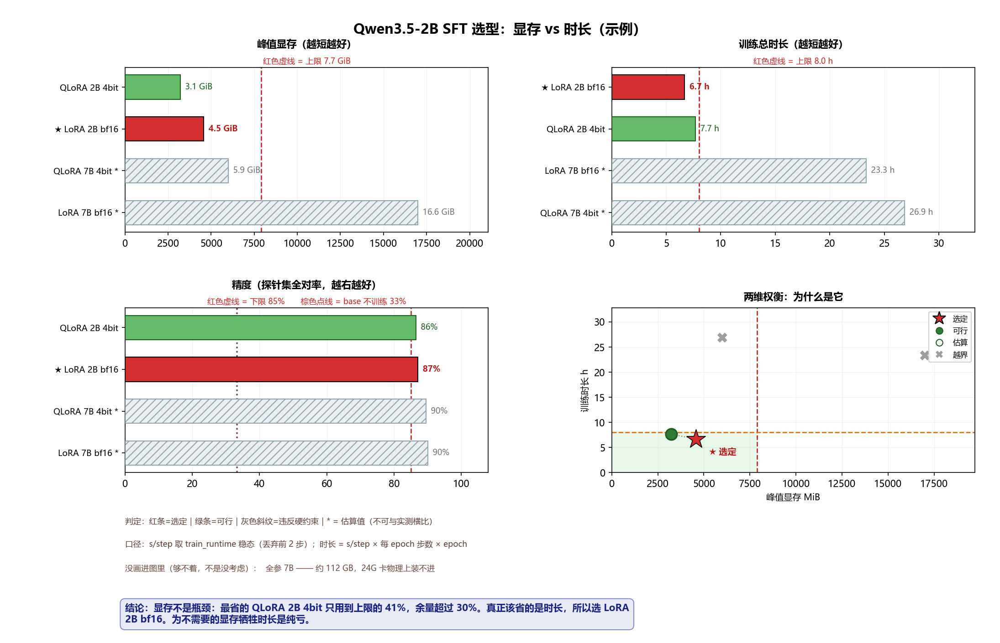
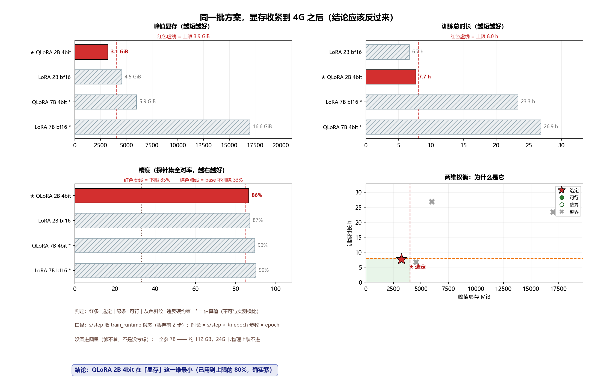

# 12 · 该省哪个：两个正交问题，两套手段

> **这篇只管"目标确定后怎么选"。**
> 前提：你已经从 `11_scope.md` 知道**唯一卡住的是哪个维度**。
> 数还没测？先回 `10_measure.md`。
>
> 读完这篇，你应该能回答：我在省显存还是省时间？该用哪张表？哪些手段会把我拖回原点？

## 一、先拆账：显存、时间、钱是三本账

同一个"便宜"，可能是三件完全不同的事：

| 你在省什么 | 典型触发 | 该动的手段 | **不该动的** |
|---|---|---|---|
| **显存**（空间） | 卡装不下、想上更大模型、想拉更长上下文 | QLoRA、gradient checkpointing、offload、降 batch | 别为了显存去换更快的小模型（那是改精度） |
| **时间**（速度） | 等不起、一天跑不了几个实验 | packing、快 kernel、小模型、多卡 | **别撤掉省显存的手段**（见第三节） |
| **钱**（租卡费） | 按 GPU-hours 计费 | 先看哪个是瓶颈，再按上两行动 | 别把时间和显存折成一个分 |

**这三者不能加权成一个"综合成本"。** 一加权就要选系数，系数一拍，结论就变成主观的。

> **这是本篇存在的原因。** 第一版我把显存和时间折成了一个"成本"，
> 结果 QLoRA 在单个轴上"既是正又是负"，我只能把它踢出表，还写下"它又慢又贵"——
> **把买显存的价钱当成了手段的缺点**。完整复盘见 `09_real_cases.md` 案例 14。

### 关于"5 天 vs 4.5 天"

这个例子值得单说，因为它常被误读。

**不是说这两个数"差不多"所以不用管**，而是：

> **当你的目标是省显存时，时间上的 5 天和 4.5 天根本不该进入决策。**

因为时间在这一轮里只是**护栏**（只要别超过你能等的那一档），不是**目标**。
拿护栏上的差异去做取舍，等于用一把量错东西的尺子。

| 你的处境 | 5 天 vs 4.5 天的意义 |
|---|---|
| 目标是省显存，时间只是"别超过一周" | **不该比较**。两者都在档内，选省显存的那个 |
| 目标是省时间，且 4.5 天能跨进"三天出结果" | 有意义，但要看跨档值不值 |
| 目标是省时间，但两者都在"一周"档内 | 仍不该比较，差异在人感知范围外 |

**先定目标，再决定哪个数字值得看。** 顺序反了，就会在错误的地方精细。

---

## 二、两张表：省显存的、省时间的

### 2.1 省显存的手段（**代价一定是变慢或掉精度**）

按"性价比"排序，从上往下试：

| 手段 | 省多少 | **付出什么** | 备注 |
|---|---|---|---|
| **QLoRA（4bit 基座）** | 2B：−29.5%<br>7B：−60~70% | 慢 15%（2B）/ 30~50%（7B） | 显存不够时的第一选择 |
| gradient checkpointing | −30~50% | 慢 20~30% | QLoRA 之后还不够时加 |
| 降 `per_device_bs` + 加 `grad_accum` | 近似线性 | 慢（GPU 利用率下降） | 保持有效 batch 不变，只换组合方式 |
| 降 `seq_len` | 近似线性 | **截断数据 → 精度可能掉** | 先看 token 分布再定 |
| offload（CPU / NVMe） | −50% 以上 | 慢 50~100%+ | 最后手段，能不用就不用 |
| 冻结底层 | 视层数 | **精度可能掉** | 少数场景有效 |

**这张表里没有一个"免费"的。** 每个都要拿时间或精度去换。
所以用之前必须明确：**我是在买显存，这笔钱我认。**

**买完就结束**——不要因为"顺便还能更快"去折腾它，那不是它的职责。

> **表里的数字怎么用**：`2B：−29.5%` 是本机实测；`7B：−60~70%` 是文档里的通用经验值。
> **凡是你自己的模型和卡，都要按 `10_measure.md` 第一节测一次再填**。
> 这些数字只用来判断"这项值不值得试"，不用来算预算。

### 2.2 省时间的手段（**代价是多占显存或掉精度**）

| 手段 | 快多少 | **付出什么** | 你的现实里有没有这一项 |
|---|---|---|---|
| **开 packing** | 2~3× | 峰值显存略增 | **有**，几乎必开 |
| flash attention / 快 kernel | 1.3~2× | 显存略降 | **有**，两项都赚 |
| 增大 batch（显存够时） | 1.2~1.5× | 显存大增 | 有，但会挤掉显存余量 |
| 减数据 / 减 epoch | 近似线性 | 精度可能掉 | 有，先看曲线平台期 |
| 换更小的模型 | 3~4× | **精度可能掉 3~6 点** | **A 类现实通常没有**（模型已指定） |
| 多卡 / ZeRO | ~N× | 通信开销 | **A 类现实没有**（就一张卡） |
| 调 lr / warmup / scheduler | **1.0~1.1** | **可能掉很多精度** | 有，但**最后才碰，通常不值得** |

**右边那列是重点。** 列了"多卡 ~N×""换小模型 3~4×"却不说**多数人根本没有这两个选项**，
等于让人以为自己漏了什么。**表里留下的必须是你真的能动的东西。**

**"又省又快"的方案，代价藏在第三列。** 换小模型看起来全面更优，
但它是拿精度换的——如果掉出了精度下限，直接出局。

### 2.3 packing 为什么是最划算的一项

padding 是纯浪费。样本长度长尾（多数 200 token，少数 2000），按 `max_len=2048` 补齐，
**80% 的算力在算 pad token**。packing 把多条短样本拼进一个序列，
有效 token 占比能从 20% 提到 90% 以上。

**先量化你的浪费**（这一步必须自己算一次）：

```bash
python scripts/check_dataset.py data/train.jsonl --tokenizer <id> --seq-len 2048
# 看各分位数 → 中位数 / max_len 就是有效率
# 例：中位数 320，max_len 2048 → 有效率 ≈ 15.6% → 84% 算力在算 pad
```

有效率低于 50% 时，**开 packing 的收益比任何调参都大**。

### 2.4 调 lr 为什么排在最后

因为它几乎不提速（1.0~1.1×），却最容易被当成"优化训练"的手段。
它优化的是**收敛**，不是**吞吐**——收敛快慢影响要跑多少步，吞吐快慢影响每步多久。

这两件事经常被混为一谈：
"我调了 lr，训练快多了" 通常指的是**几步就收敛了**，不是**每步更快了**。

---

## 三、反例：拿省显存的手段去解速度问题

**这是最容易犯、也最贵的错。**

```
显存不够 → 上 QLoRA → 训练变慢 → "QLoRA 太慢，换回 LoRA"
        → OOM → 再上 QLoRA → 原地打转
```

问题在于：把"QLoRA 慢"当成了它的缺陷，试图用"撤掉 QLoRA"来解决速度。
**但撤掉 QLoRA，显存问题立刻回来。**

正确链条：

```
显存不够 → 上 QLoRA（买显存，付时间）
        → 检查：时间还在档内吗？
           ├── 在  → 结束。不要再去优化那点时间
           └── 不在 → 用【2.2 表】补：开 packing、换快 kernel
                     QLoRA 不动
```

**对照表**：

| 你的问题是 | 用 | **不要用** |
|---|---|---|
| 显存装不下 | 2.1 表 | 换小模型（那是改精度，不是省显存） |
| 训练太慢 | 2.2 表 | **撤掉 QLoRA / ckpt**（会 OOM，回到原点） |
| 精度不够 | 加数据 / 加 epoch / 换大模型 | 调 lr（收益最不确定） |

**原则**：

> **手段要匹配问题。**
> A 手段的副作用，用 B 手段去补偿，**但绝不能靠"取消 A"来解决**——
> 取消 A，A 要解决的问题就回来了。

---

## 四、选方案：三步筛选

### 4.1 A 类现实：模型已指定，只能动开关

以 2B 模型、8G 卡（可用 7.2G）、一下午 4 小时为例：

| 候选 | 峰值显存 | 时长 | 判断 |
|---|---|---|---|
| seq=1024 + LoRA | 4566 MiB | 3.20 s/step | **显存够 → 选它** |
| seq=1024 + QLoRA | 3220 MiB | 3.68 s/step | 省 1.3G，但你不需要 → **纯亏 15%** |
| seq=1024 + LoRA + ckpt | 约 3200 MiB | 约 4.0 s/step | 省得动但慢 → 显存够时别加 |
| seq=4096 + LoRA | 逼近硬顶 | 更慢 | **这时显存才卡住** → 换 QLoRA |

**A 类的候选通常只有 3~4 个，而且都是开关的组合**，不是"换不换模型"。
先跑一次 smoke test 拿到真实显存，表一填，答案自动出来。

### 4.2 B 类现实：模型可以换

以 24G 单卡、目标"省显存"为例：

| 候选 | 峰值显存 | 相对时长 | 精度 | 判断 |
|---|---|---|---|---|
| 全参 7B | 112 GB | — | 88% | ✗ 装不下，出局 |
| **QLoRA 7B** | **6 GB** | 1.4× | 85.5% | **显存最省 → 选它**（目标是显存） |
| LoRA 7B | 17 GB | 1.0× | 87% | 次省，且更快 |
| LoRA 2B | 4.5 GB | 0.25× | 81% | 更快更省，但精度可能不够 |

**注意最后两行的诱惑**：LoRA 2B 又省又快，看起来"全面更优"。
但它是**用精度换来的**——如果 81% 掉出了精度下限，它直接出局。

**同一张表，目标换成时间，答案立刻反过来**（LoRA 7B 或 2B 胜出）。
这就是为什么必须先确定在省什么，而不是先列表。

### 4.3 三步

```
第 1 步  划掉跨出区间的（显存超 / 精度不够）
第 2 步  在剩下的里面，只看【目标维度】排序
第 3 步  目标维度接近的，选实现简单、依赖少的（少一个库 = 少一个坑）
```

### 4.4 把它画出来：一张图说清"为什么选它、为什么淘汰别的"

选型结论最终要给别人看（你自己一周后也算别人）。表格能表达，但图更快——
**淘汰原因、可接受区域、帕累托关系，一眼就能看到**。

```bash
python scripts/plot_plan.py --plan plan.json --out plan.png --objective vram
python scripts/plot_plan.py --plan plan.json --objective time    # 目标换时间
```

`plan.json` 的最小结构：

```json
{
  "steps_per_epoch": 2500, "epochs": 3, "baseline_quality": 0.333,
  "constraints": {"max_vram_mib": 7899, "max_hours": 8.0, "min_quality": 0.85},
  "points": [
    {"name": "LoRA 2B bf16",  "vram_mib": 4566, "s_per_step": 3.20, "quality": 0.87, "measured": true},
    {"name": "QLoRA 2B 4bit", "vram_mib": 3220, "s_per_step": 3.68, "quality": 0.865, "measured": true}
  ],
  "excluded": [{"name": "全参 7B", "reason": "约 112 GB，装不进"}]
}
```

**四格：显存 / 时间 / 精度 各一格条形，加一格两维散点。**

为什么精度单独给一格，而不是塞进散点当第三轴（气泡大小）：**85% 和 87% 的差别，
在气泡上根本看不出来**，而它恰恰决定了达标与否。分开画，每个维度都能直接比，
也不用把三个数折成一个"综合分"。

四格的分工：

| 格 | 回答什么 |
|---|---|
| 左上：显存条形 | 谁最省显存、差多少、有没有越顶 |
| 右上：时间条形 | 谁最快、慢的代价是多少 |
| 左下：精度条形 | 谁达标、**离下限几个点**、比 base 涨了多少 |
| 右下：散点 | 两维上的位置关系——**为什么是它，不是旁边那个** |

左下那张有个反直觉的地方值得盯：**精度最高的方案可能是灰色的**。
因为它超了显存或时间，再准也进不了候选。这正是"单看精度会选错"的图证。

#### 同一批方案，约束一变，结论就反

下面两张是同一组候选（数字取自本机实测 + 估算），**只有显存上限不同**：

| | 显存上限 7.7 GiB（宽裕） | 显存上限 4 GiB（紧） |
|---|---|---|
| 结论 | **LoRA 2B** | **QLoRA 2B** |
| 理由 | 显存只用 41%，**不是瓶颈**；该省的是时长 | 显存用到 80%，**确实紧**；只能选它 |
| QLoRA 的命运 | 可行，但**选它是纯亏**（慢 15% 换不需要的显存） | 唯一出路 |
| 精度 90% 的 7B 方案 | 灰（超时） | 灰（超时＋超显存） |





**这两张图放在一起，比任何一段文字都能说明"两个正交问题"**：
- 左边：显存有大量余量时，为它牺牲时间是亏的
- 右边：显存真卡住时，慢就是该付的价钱

脚本会自动判断"目标维度是不是真的紧"（最省方案占上限 < 70% 就判为不紧，
可用 `--slack` 调）。所以它给出的结论不是机械的"取最小"，而是
**先问这个维度值不值得优化**。

#### 读图只看三处

| 看哪 | 说明什么 |
|---|---|
| 灰斜纹有多少行 | 全是斜纹 → 约束定得太死，必须放宽一个；≥2 行有色 → 有得选 |
| 红条落在哪 | 按目标维度最靠边、且三个维度都没越界的那个 |
| 灰条为什么灰 | **淘汰原因**。如果时间格里灰的一片、显存格里还有绿的，说明该省时间了，不是该换模型 |

**灰条不一定差**：它可能只是某一维越界。三格连起来看，才知道是"能力不够"还是"超预算"。

#### 三条不许（都是踩过的坑）

1. **不许把估算值画成实测**：条形图里用 `*` 后缀，散点里用空心圆，图例注明。
   混在一起，看图的人会以为它们同等可信。
2. **不许跨实验混数据**：s/step 必须同一口径（`train_runtime` 稳态，丢前 2 步）。
   两张表的点画在一张图上，等于案例 13 那个错误换了个形式。
3. **不许偷偷丢掉够不着的选项**：全参 7B 这类远超范围的，写进 `excluded`
   并说明原因。**画不下 ≠ 没考虑**，但不说清楚，别人会以为你漏了。

#### 环境：WSL / Linux 上没有中文字体

```bash
fc-list :lang=zh | wc -l        # 返回 0 = 没有
```

没有的话，图上中文全是**方块**（脚本会自动降级成英文并在终端警告）。
装一次就够：

```bash
sudo apt update && sudo apt install -y fonts-noto-cjk
# 不用重启，重新跑脚本就显示中文
```

Windows 侧自带微软雅黑，不用装。**同一份 plan.json 在两边画出来的图语言不同，不是 bug。**

实测（2026-11-16）：WSL Ubuntu 默认 `fc-list :lang=zh` 为 0 条。

---

## 五、档内不再排序，以及什么时候停

| 情况 | 做法 |
|---|---|
| 两个方案**同档** | **视为等价**，选实现简单的那个 |
| 一个跨档、一个不跨 | 选不跨档的，除非跨档能换来精度档的跃升 |
| 都在档内，但一个明显更省 | 选更省的——**前提是它不带来新的复杂度** |

**"明显更省"的判据不是 5%、10%**——那在测量噪声里（同配置跑两次差 5~10% 很常见）。
只有当差异**大到能跨一个档**（或超过 30~50%），才值得为它换方案。

### 执行顺序

```
1. 确定在省什么（显存 / 时间）—— 只有一个
2. 打开对应的表（2.1 / 2.2）
3. 从表顶往下试，一次只改一个
4. 每改一个，检查【另一个维度】是否跨出区间
5. 跨出去了 → 用另一张表补偿，不是撤销刚才那一步
6. 两个维度都在档内 → 停
```

**第 6 步是最难的**。人的本能是"既然还能再省点，就再省点"。
但档内再省，省的是别人感知不到的东西，花的是你的时间。
**在档内停下来，是一种能力。**

---

## 六、只带走两句话

如果这篇只记住两点：

> **1. 显存和时间是两个正交问题。**
> 省显存的手段（QLoRA / ckpt / offload）一定让你变慢，那是**价钱**，不是缺点。
> 慢要用省时间的手段去解（packing / 快 kernel），**不能靠撤掉 QLoRA**——
> 撤掉它，显存问题立刻回来。
>
> **2. 目标是唯一的，护栏是另一个。**
> 一次只优化一个维度，另一个只要在档内就别管。
> 5 天 vs 4.5 天、10 分钟 vs 15 分钟，当它不是你的目标时，**连比较的资格都没有**。

**其余的（公式、字段名、手段表）都是这两句的展开。**
两句记住了，具体数字忘了也能重新测；两句没记住，数字背得再熟也会用错地方。

---

## 七、这篇和别处的关系

| 想知道 | 去哪 |
|---|---|
| 怎么测出表里的数字 | `10_measure.md` |
| 多少算够、卡在哪个区间 | `11_scope.md` |
| 把三篇串起来练一遍 | `13_practice.md` |
| 三档精度的显存估算、长上下文 | `02_decide.md` |
| 具体怎么开这些开关 | `04_train.md` |
| 两维搞混的完整复盘 | `09_real_cases.md` 案例 14 |

**这一篇只管"选哪个"，不管"怎么开"。**
参数怎么填在 04，数字怎么测在 10。
